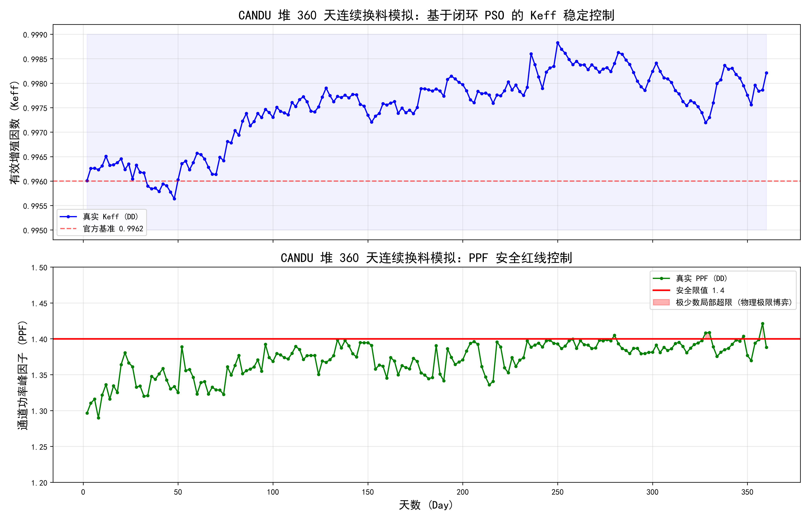

# DONJON 部分：CANDU-6 长周期连续换料序列优化

> 这个文件夹不是 DONJON 教程（教程在 [../代码区](../代码区/README.md) 和 [../IGE 重构](../IGE%20重构/IGE335/README.md)）。
> 这里是**用 DONJON 做的科研**：代码、参数、每个阶段的实验记录，都在这。

一句话：**CANDU-6 重水堆不停堆连续换料，每一步换哪 4 根通道是要决策的。用 PSO 搜索 + 神经网络代理模型打分，再用 DONJON 做真实物理校验，把 360 天（180 步）的换料序列自动优化出来，让 Keff 稳在 0.997 附近、PPF 压在 1.4 以下。**

---

## 0. 三分钟速览（给第一次看这个仓库的人，包括导师）

| 项目 | 内容 |
| --- | --- |
| 研究对象 | CANDU-6 重水堆（压力管式，天然铀，不停堆换料） |
| 物理引擎 | DONJON 5（读 DRAGON 生成的少群截面，解三维扩散） |
| 决策变量 | 每隔一段时间换哪 4 根燃料通道（从 380 个合法通道里选） |
| 目标 | Keff 贴近 1（不塌、不超），PPF（通道功率峰因子）≤ 1.4 |
| 优化算法 | 离散 PSO 为主，GA / DBO 做对照 |
| 加速手段 | BP 神经网络代理模型（500 条 DONJON 样本训练），单次推理 < 1 ms |
| 闭环机制 | 代理模型选 Top 候选 → DONJON 真算 → PPF 超标就拉黑该组合 → PSO 重搜 |
| 主结果 | 180 步 / 360 天全程走完：Keff 0.9960 → 0.9982（全程 0.9956~0.9988，均值 0.9975）；PPF 均值 1.37，175/180 步在 1.4 以下，5 步微超（最高 1.4214） |
| 单次 DONJON 计算 | 约 3~4 秒（同一台机器实测，见 `SOMESTUFFS/Material/pso与ga的对比/temp_run.log` 结尾） |
| 纯 DONJON 直接搜索为什么不行 | 380 选 4 共约 8.5 亿种组合，单次 4 秒，穷举不现实 |

**结论一句话**：代理模型负责"快速筛"，DONJON 负责"最终判"，两者串成闭环，才把 180 步的长周期搜索压到可接受的时间内。

---

## 1. 技术路线

```
                ┌─────────────────────────────────────────────┐
                │  通道清单 channels_list.txt（380 个合法通道） │
                └───────────────────┬─────────────────────────┘
                                    │
        ┌───────────────────────────▼────────────────────────────┐
        │ 内层：离散 PSO（30 粒子 × 30 代，每次决策 4 个通道）      │
        │ 适应度 = Keff − 50·max(0, PPF−1.35)                    │
        │          − 空间聚集惩罚 − 历史防重惩罚                    │
        │ 打分由 BP 代理模型给出（numpy 前向，< 1 ms/次）           │
        └───────────────────────────┬────────────────────────────┘
                                    │ 输出 Top 候选
        ┌───────────────────────────▼────────────────────────────┐
        │ 外层：DONJON 真实计算（约 4 s/次）                        │
        │ 读到 Keff / PPF / 最大通道功率                           │
        │ PPF > 1.4 → 该组合进黑名单 → 回到内层重搜（最多 5 次）     │
        └───────────────────────────┬────────────────────────────┘
                                    │ 通过
        ┌───────────────────────────▼────────────────────────────┐
        │ 记入 history（这一步的换料进入后续所有计算的历史）         │
        │ → 下一步。循环 180 步 = 360 天                            │
        └────────────────────────────────────────────────────────┘
```

三个建模上的选择，都是被"算不动"逼出来的：

1. **换料量固定为 4 根/步**：与官方 CANDU-6 基准题的换料节奏对齐，也把搜索维度压到 4。
2. **适应度用罚函数而不是硬约束**：PPF 超线时用斜率 50 的线性罚把解压回可行域，Keff 始终是主导项（刘仕倡 2013 的罚函数思路）。
3. **两条额外的物理约束**（王德营 2024 "换料影响指数"的思路简化版）：
   - **空间防聚集**：4 根通道在通道编号上间距小于 8 时扣分，避免局部功率畸变；
   - **历史防重**：最近 15 步内换过的通道再换，扣 50 分，避免反复折腾同一片区域。

---

## 2. 目录与文件

```
DONJON/
├── README.md                  ← 本文件
├── requirements.txt           ← Python 依赖
├── check_env.py               ← 环境自检（导师拿到仓库先跑这个）
│
├── 自动化/                     ← 第一阶段：单时间步，纯 DONJON 驱动
│   ├── auto_run.py            写 x2m → 调 rdonjon → 正则解析 .result（核心，所有算法都 import 它）
│   ├── pso_optimizer.py       离散 PSO（20 粒子 × 20 代）
│   ├── ga_optimizer.py        GA 对照（20 个体 × 20 代）
│   ├── extract_channels.py    从 .result 里抠合法通道名（已被下面这个取代）
│   ├── extract_from_c2m.py    从 SetFuelMap.c2m 里抠合法通道名（正确做法，产出 channels_list.txt）
│   └── plot_results.py        PSO / GA 收敛曲线
│
├── 多时间步/
│   ├── Continuous_360/        ← 第二阶段：多步串联（纯 DONJON，无代理模型）
│   │   ├── auto_run_restart.py    每步把历史换料重放一遍再算（见 §7 的说明）
│   │   ├── main_360_pso.py        逐步 PSO（3 粒子 × 3 代，为了跑得动）
│   │   ├── main_test_restart.py   随机换料的对照组（Keff 会一路下跌）
│   │   └── plot_daily.py          逐日 Keff / PPF 曲线
│   └── ai_accelerator/        ← 第三阶段：代理模型 + 闭环（主结果出处）
│       ├── generate_dataset.py    随机采样 500 组 → DONJON 算 → dataset.csv
│       ├── train_bp.py            PyTorch 训练 BP（380×4 → 256 → 128 → 2），导出 weights.npz
│       ├── predict_numpy.py       纯 numpy 前向推理（目标机上不需要装 torch）
│       ├── dd_restart_evaluator.py DONJON 真实校验（带历史重放）
│       ├── main_360_pso.py        闭环主程序，180 步 / 360 天
│       └── plot_results.py        最终 360 天结果图
│
├── DBO/
│   └── dbo_optimizer.py       ← 蜣螂优化 DBO 对照（结论：离散化水土不服，见 §8）
│
└── SOMESTUFFS/                ← 每个阶段做了什么、当时的截图和数据
    ├── README.md              阶段索引，建议先看这个
    └── Material/              原始输出：csv、png、log、.result
```

**产物对照**：

| 脚本 | 输出文件 |
| --- | --- |
| `自动化/pso_optimizer.py` | `pso_history.csv` |
| `自动化/ga_optimizer.py` | `ga_history.csv` |
| `DBO/dbo_optimizer.py` | `dbo_history.csv` |
| `多时间步/Continuous_360/main_360_pso.py` | `daily_optimization_history.csv` |
| `多时间步/ai_accelerator/main_360_pso.py` | `optimization_history_closedloop.csv` |
| `多时间步/ai_accelerator/generate_dataset.py` | `dataset.csv`（增量写入，可断点续跑） |
| `多时间步/ai_accelerator/train_bp.py` | `weights.npz` |

仓库里已经带了跑出来的结果，位置在 `SOMESTUFFS/Material/`：

- `Material/BP/dataset.csv`：500 条训练样本
- `Material/BP/weights.npz`：训练好的权重（可直接推理，不用重训）
- `Material/BP/optimization_history_closedloop.csv`：180 步闭环结果
- `Material/BP/final_360_days_result.png`：最终图
- `Material/pso与ga的对比/`：PSO / GA / DBO 三方对比数据与图
- `Material/多时间步/`：30 天多步模拟与对照组

---

## 3. 环境要求

### 3.1 必须先有的东西（仓库里没有、也放不进来）

| 依赖 | 说明 |
| --- | --- |
| **DONJON 5** | Linux 上编译好的版本，根目录下有可执行脚本 `rdonjon`。DRAGON/DONJON 由 École Polytechnique de Montréal 维护，需向作者申请或使用实验室已有安装（NEA 数据银行 / 官方 GitLab 也有源码） |
| **官方 CANDU-6 基准算例** | `data/Candu6.x2m`、`Candu6_proc/`（含 `SetFuelMap.c2m` 等过程文件）、`Candu6.access`；以及 `Linux_x86_64/` 输出目录 |
| **群常数库** | 官方 CANDU-6 算例自带（本工作没有重新用 DRAGON 生成截面库，沿用官方库） |

> DONJON 本体和官方算例都因版权/体量原因不入库。**没有它们，本目录的代码一行也跑不起来**——这是复现的第一道门槛，所以写在最前面。

### 3.2 Python 侧

```bash
python3 -m pip install -r requirements.txt
```

- Python ≥ 3.8
- `numpy`、`pandas`、`matplotlib`：跑算法与画图必需
- `torch`：**只有 `train_bp.py` 需要**（训练阶段）。推理用 `predict_numpy.py`，只要 numpy，所以目标机上不装 torch 也能跑闭环

---

## 4. 部署：从 clone 到跑通（导师的机器照这个走）

### 关键前提：工作目录必须是 DONJON 根目录

所有脚本里的路径都是**硬编码**的：

```python
run_file    = "data/Candu6.x2m"                       # 会覆盖官方基准题输入卡
result_file = "Linux_x86_64/Candu6.result"
subprocess.run(["./rdonjon", "Candu6.x2m"])
```

也就是说，**必须在 `Version5_evn/Donjon/` 这一层执行**（这一层能看到 `rdonjon`、`data/`、`Candu6_proc/`、`Linux_x86_64/`）。
不要在 `DONJON/自动化/` 里面直接 `python3 pso_optimizer.py`，会报找不到 `rdonjon`。

### 步骤

```bash
# 1. 装好 DONJON 5，先确认官方算例本身是通的
cd ~/Version5_evn/Donjon/
./rdonjon Candu6.x2m
# 期望：Linux_x86_64/Candu6.result 里 K-EFFECTIVE = 0.99625，且没有 TEST FAILURE

# 2. 备份官方输入卡（脚本会覆盖它！）
cp data/Candu6.x2m data/Candu6.x2m.bak

# 3. 把本目录的脚本放进来（拷进来或软链，别在 Donjon 目录外面跑）
REPO=<仓库路径>/DONJON
cp -r $REPO/自动化 $REPO/DBO $REPO/多时间步 $REPO/check_env.py .

# 4. 设 PYTHONPATH：脚本之间是 `from auto_run import evaluate` 这种同目录导入，
#    但工作目录必须留在 Donjon 根目录，所以用环境变量把脚本目录补进路径
export PYTHONPATH=$PWD/自动化:$PWD/多时间步/ai_accelerator:$PWD/多时间步/Continuous_360

# 5. 通道清单（380 行）：仓库里带了就直接拷，没有就现生成（二选一）
cp $REPO/channels_list.txt .
# 仓库里没有这份清单时，改用：
#   python3 自动化/extract_from_c2m.py    # 输入 Candu6_proc/SetFuelMap.c2m
# 检查：wc -l channels_list.txt 应为 380
# 注意：清单必须和 weights.npz 用同一份，否则通道索引会错位（见 §7 第 5 条）

# 6. 环境自检
python3 check_env.py

# 7. 单步冒烟：随便换 4 根通道，看能不能拿到 Keff / PPF
python3 -c "from auto_run import evaluate; print(evaluate(['U11','R20','P06','K07']))"
# 期望：类似 (0.9961516, 1.2999, ...)，耗时约 4 秒
```

第 7 步过了，剩下的都只是"跑多久"的问题。

> 如果导师的机器是 Windows：DONJON 只有 Linux 版，走 WSL2 或装一台 Ubuntu 虚拟机，**不要在 Windows 原生 Python 里试**。

### 运行位置（这一步最容易错，单独列出来）

| 脚本 | 必须在哪个目录执行 |
| --- | --- |
| `自动化/pso_optimizer.py`、`ga_optimizer.py`、`DBO/dbo_optimizer.py` | Donjon 根目录（cwd 决定 `data/` 和 `./rdonjon` 的路径） |
| `多时间步/ai_accelerator/main_360_pso.py` | Donjon 根目录（同上） |
| `多时间步/ai_accelerator/generate_dataset.py`、`train_bp.py` | `多时间步/ai_accelerator/` 目录内（按当前目录找 `dataset.csv`、`weights.npz`） |
| `多时间步/ai_accelerator/predict_numpy.py` | 任意（权重按脚本自身所在目录找） |
| `多时间步/ai_accelerator/plot_results.py` | Donjon 根目录（从 cwd 读 `optimization_history_closedloop.csv`） |
| `多时间步/Continuous_360/plot_daily.py` | Donjon 根目录（从 cwd 读 `daily_optimization_history.csv`） |
| `check_env.py` | Donjon 根目录 |

### 两个不在脚本目录的数据文件

仓库把下面两个文件放在 `SOMESTUFFS/Material/BP/`，用之前拷过去：

```bash
cp $REPO/SOMESTUFFS/Material/BP/dataset.csv  $REPO/多时间步/ai_accelerator/
cp $REPO/SOMESTUFFS/Material/BP/weights.npz  $REPO/多时间步/ai_accelerator/
```

**注意**：`weights.npz` 是跟 `channels_list.txt` 的行顺序绑定的（第 i 行 = 索引 i 的 one-hot 位置）。通道清单一旦重新生成且顺序变了，权重就必须重训，否则预测全错。这一点在 §7 再提一次。

---

## 5. 复现各个阶段的实验

以下命令都在 `Version5_evn/Donjon/` 下执行（`check_env.py` 建议先过一遍）。
**例外**：`generate_dataset.py` 与 `train_bp.py` 要在 `多时间步/ai_accelerator/` 目录内执行（原因见上表）。

| 阶段 | 命令 | 规模 | 大致耗时 | 产物 |
| --- | --- | --- | --- | --- |
| 单时间步 PSO | `python3 自动化/pso_optimizer.py` | 20 粒子 × 20 代 = 400 次 DONJON | 约 25 分钟 | `pso_history.csv` |
| 单时间步 GA 对照 | `python3 自动化/ga_optimizer.py` | 同上 | 约 25 分钟 | `ga_history.csv` |
| DBO 对照 | `python3 DBO/dbo_optimizer.py` | 同上 | 约 25 分钟 | `dbo_history.csv` |
| 多时间步（纯 DONJON） | `python3 多时间步/Continuous_360/main_360_pso.py` | 默认 10 步（约 27 天，`total_steps` 可改） | 约 6~8 分钟 | `daily_optimization_history.csv` |
| 随机换料对照组 | `python3 多时间步/Continuous_360/main_test_restart.py` | 10 步随机 | 约 1 分钟 | 屏幕输出，对照组图见 `Material/多时间步/对照组.png` |
| 生成训练集 | `cd 多时间步/ai_accelerator && python3 generate_dataset.py` | 500 条样本 | 约 30 分钟（4 s/条） | `dataset.csv` |
| 训练代理模型 | `cd 多时间步/ai_accelerator && python3 train_bp.py` | 200 epoch | 几分钟（CPU 即可） | `weights.npz` |
| **闭环主结果** | `python3 多时间步/ai_accelerator/main_360_pso.py` | 180 步 / 360 天 | 约 20 分钟 | `optimization_history_closedloop.csv` |
| 出图 | `python3 多时间步/ai_accelerator/plot_results.py` | — | 秒级 | `final_360_days_result.png` |
| 多步出图 | `python3 多时间步/Continuous_360/plot_daily.py` | — | 秒级 | `daily_optimization_30days.png` |

**为什么闭环反而最快**：每步只有 1 次真实 DONJON（约 4 s），其余 900 次打分全在 numpy 里做（< 1 ms 一次）。纯 DONJON 版本每步要真算 9 次（3 粒子 × 3 代），所以只能跑 10 步看趋势——这就是加代理模型的动机。

想只验证流程、不花 20 分钟：把 `main_360_pso.py` 里的 `total_steps = 180` 改成 `10`，跑 10 步看 Keff 是否稳住即可。

---

## 6. 关键参数在哪

| 参数 | 文件 | 当前值 | 说明 |
| --- | --- | --- | --- |
| 每步换料数 | 各 `*_optimizer.py` | 4 | 与官方基准题节奏一致 |
| 粒子数 / 代数 | `自动化/pso_optimizer.py` | 20 / 20 | 纯 DONJON 阶段，受限于算力 |
| 粒子数 / 代数 | `多时间步/ai_accelerator/main_360_pso.py` | 30 / 30 | 代理模型打分，便宜 |
| 惯性权重 / 学习因子 | 同上 | 0.5 / 1.5 / 1.5 | 离散 PSO 常用取值 |
| PPF 罚函数拐点 | `calc_score` / `calc_fitness` | 1.4（DD）、1.35（AI） | 超线部分斜率 50 |
| 历史防重窗口 | `main_360_pso.py` | 最近 15 步 | 命中一次扣 50 |
| 空间聚集阈值 | `main_360_pso.py` | 通道编号间距 < 8 | 每单位扣 0.05 |
| 闭环重搜上限 | `main_360_pso.py` | 5 次 | 5 次仍不过就记录真实值强行推进 |
| 时间步长 | 见下方说明 | 0.2+2.7 / 1.0+1.7 / 0.8+1.2 | 三个阶段的时间步设定不同，见 §6.1 |
| 通道数 | `predict_numpy.py` / `train_bp.py` | 380 | 与实际清单长度必须一致 |

### 6.1 三个阶段的时间步不一样（别混用）

| 阶段 | 每步时间设置 | 每步天数 | 说明 |
| --- | --- | --- | --- |
| `自动化/auto_run.py`（单时间步） | `TIME 0.2 DAY` → 换料 → `TIME 2.7 DAY` | 2.9 天 | 沿用官方基准题的节奏，只优化"这一次换 4 根" |
| `多时间步/Continuous_360/auto_run_restart.py` | 每步 `TIME 1.0 DAY`，末尾 `1.7 DAY` | 2.7 天 | 多步串联的早期版本，所以 30 天只需 11 步左右 |
| `多时间步/ai_accelerator/dd_restart_evaluator.py` | 每步 `TIME 0.8 DAY`，末尾 `1.2 DAY` | 2.0 天 | 主结果用这个：180 步 × 2 天 = 360 天 |

要改模拟周期就去改这几个 `TIME` 字面量，**改完记得同步改主程序里的步数**，否则天数和步数会对不上。

---

## 7. 几个必须知道的实现细节（也是坑）

1. **"restart" 目前是历史重放，不是真正的 DONJON restart。**
   `evaluate_restart()` 每步都把 `history + [当前]` 整条换料序列从第 0 天重新算一遍。好处是状态一定自洽、不会累积误差；坏处是第 n 步要算 n 个时间步，总成本随步数平方增长。
   仓库里没有使用 DONJON 的 `SAVE`/`RESTART` 文件。

2. **每步都会覆盖 `data/Candu6.x2m`。**
   因为 DONJON 的输入卡必须放在 `data/` 下、名字必须对上 `Candu6.access`。所以：**先备份**，且不要在同一个目录里并行跑两个脚本。

3. **每次计算只保留一个 `Candu6.result`**（先删后算），历史结果靠写 csv 保存，不靠堆 result 文件。

4. **`channels_list.txt` 必须来自 `Candu6_proc/SetFuelMap.c2m` 的 MIX 矩阵**，不能用 `.result` 里的通道名——有些通道没装燃料，被选到会直接算崩。这是 `extract_channels.py` 被 `extract_from_c2m.py` 取代的原因。

5. **通道索引 = `channels_list.txt` 的行号**，代理模型的输入是 4×380 的 one-hot。所以清单顺序变了、或通道数不是 380，权重就废了。

6. **所有脚本都没有固定随机种子**，重跑结果会和仓库里的 csv 不完全一样（趋势一致，具体最优序列会变）。想严格复现某次结果，需要自己加 `random.seed(...)` 和 `np.random.seed(...)`。

7. **没有超时保护**：`subprocess.run` 没设 `timeout`，DONJON 卡住（比如输入卡不合法一直迭代）会让脚本一直挂着。跑长任务时建议 `nohup` 后台跑 + 看 `temp_run.log`。

8. **中文图在 Linux 上会变方框**：`plot_results.py` 里写死了 `SimHei`，服务器一般没这个字体。要么装中文字体，要么把该行改成 `plt.rcParams['font.sans-serif'] = ['Noto Sans CJK SC']`（或干脆去掉中文标签）。

---

## 8. 已知局限（写在这里，免得被问）

- **代理模型是外推失效的**。单 BP 在长周期深燃耗下会失真，所以必须留一层真实 DONJON 校验；不能把代理模型的预测当成结果用。
- **PPF 有 5 个点微超 1.4**（Day 280、328、330、348、358，最高 1.4214），其余 175 步都在线内。超线都集中在 300 天以后，说明深燃耗末段可用通道的功率分布已经很难再压平，属于物理上的局部极限，不是搜索没搜到。
- **Keff 是一路往上漂的**（0.9960 → 0.9982），因为适应度里只有"Keff 越高越好"，没有"偏离 1 就罚"的项。堆芯其实一直处于小幅正反应性，长期看相当于慢慢把调节能力吃掉了。这是下一个该补的约束：目标改成 `−|Keff − Keff_target|` 而不是单纯最大化。
- **换料量固定 4 根**，没有联合优化"换几根 + 换哪几根"。
- **DBO 完全水土不服**：连续空间的位置更新被 `round()` 映射到离散通道号后，种群很快退化成同一批阶梯状解，收敛曲线明显差于 PSO/GA（见 `SOMESTUFFS/dbo测试.md`）。
- **单 BP 结构没做消融**：隐层 256/128 是拍的，没比较过更小/更大网络、也没试过用随机森林等基线。
- **算法对比是同一次运行的比较**：PSO / GA / DBO 各只跑了一次 20 代，没有重复实验和统计，所以"谁更好"下不了结论（详见 §9 三方对照）。
- **没有中子学意义上的验证**：目前只盯 Keff 和 PPF，没有做燃耗分布、通道功率历史、卸料燃耗等更完整的堆芯指标校核。

---

## 9. 结果

### 360 天闭环（`SOMESTUFFS/Material/BP/final_360_days_result.png`）



| 指标 | 数值（从 `optimization_history_closedloop.csv` 直接统计） |
| --- | --- |
| 模拟步数 | 180 步（2 天/步，Day 2 → Day 360） |
| Keff | 起点 0.99601，终点 0.99821；全程 0.99564~0.99883，均值 0.99749 |
| PPF | 均值 1.3706，最低 1.2899，最高 1.4214；175 步 ≤ 1.4，5 步超线（Day 280/328/330/348/358） |
| 单步耗时 | AI 搜索 < 1 s + DONJON 校验约 4 s |
| 全程耗时 | 约 20 分钟（对比纯 DONJON 逐步搜索，提效百倍以上） |

从图上看：下半张 Keff 从 0.996 一路抬到 0.998 附近并稳住（红虚线是官方基准 0.9962），上半张 PPF 从 1.29 逐步抬到 1.39，红线 1.4 只在最末段被顶破几次——**这就是"把反应性补回来、同时把功率峰因子压在红线边上"的典型走法**。

### 三方算法对照（`Material/pso与ga的对比/`）

先说结论：**这三张图都是单次运行（20 代），随机种子没固定，只能看趋势，不能当统计结论。**

- 这一组数据里：GA 第 8 代越过官方基准，第 9 代到 Keff = 0.99642 后不再动；PSO 第 1 代就 0.99634，但第 12 代"最优解"的 Keff 反而掉到 0.99631（因为适应度里含 PPF 罚项，分数更优的解 Keff 可能略低，曲线看着像"退化"）；DBO 全程没越过 0.9962。
- 另一组数据（`Material/pso与ga单时间步完全体大概/`）里方向正好相反：GA 第 2 代就越线，PSO 要到第 15 代。
- 所以能站住的结论只有两条：① 三种算法都能搜出接近或超过官方换料序列的解；② DBO 在离散通道问题上明显最差。**PSO 和 GA 谁更好，现有几次运行不足以支撑**。

要把"PSO 优于 GA"写成结论，至少得固定随机种子、每个算法重复 20~30 次，比收敛代数、最终 Keff / PPF、成功率（而不是挑一张好看的曲线）。

### 与官方基准题的一致性

先跑官方 `Candu6.x2m`，Keff = 0.99625、最大通道功率 = 6884.9 kW，误差为零，确认环境和官方结果一致；再改两根通道的换料序列，Keff 变为 0.99601，说明换料序列确实作用于物理结果（同时触发了基准题里写死的 `ASSERTS`，需注释掉才能出结果，详见 `SOMESTUFFS/CANDU6运行报告1.md`）。

---

## 10. 参考文献（本工作的思路来源）

- 霍小东 (2005)：360 天连续换料框架，本工作的蓝图。
- 刘仕倡 (2013)：用 PSO 替代 GA 做换料优化，罚函数形式的适应度。
- 王德营 (2024)："换料影响指数"思想，本工作简化为空间防聚集 + 历史防重两条惩罚。
- 王端：BP 网络结构与特征方式参考。

> 文献信息请以 `SOMESTUFFS/` 各阶段文档中的引用为准；正式投稿前需补齐完整著录。

---

## 11. 想继续做的话

- 代理模型换成"物理特征 + 通道号"的混合输入，解决外推失效；
- 用 DONJON 真正的 `SAVE`/`RESTART` 替换历史重放，把 O(N²) 降到 O(N)；
- 把 4 根固定换料量放开，做"根数 + 位置"联合搜索；
- 加固定随机种子与参数配置文件（`config.yaml`），让每一次结果都能一字不差地复现；
- 补一个 `requirements-lock.txt` 或容器镜像，彻底解决"换台机器就跑不了"的问题。

---

## 附录 A：还没修的小问题（不影响已有结果，但影响别人复现）

| # | 位置 | 问题 | 怎么修 |
| --- | --- | --- | --- |
| 1 | `多时间步/ai_accelerator/generate_dataset.py:6` | `from dd_evaluator import evaluate`，仓库里没有这个模块，一跑就 ImportError | 改成 `from auto_run import evaluate`（单步版），或 `from dd_restart_evaluator import evaluate_restart`（注意后者多一个 `history` 参数） |
| 2 | 根目录 | `channels_list.txt` 没入库，所有算法一启动就 FileNotFoundError | 跑一次 `extract_from_c2m.py` 生成；或把现有那份提交进仓库（推荐，能保证索引与 `weights.npz` 对齐） |
| 3 | `SOMESTUFFS/Material/BP/` | `dataset.csv`、`weights.npz` 不在脚本目录，`train_bp.py` 直接跑会找不到 | 按 §4「两个不在脚本目录的数据文件」拷过去；或把路径改成相对 `__file__` 定位 |
| 4 | `SOMESTUFFS/dbo测试.md` | "GA数据" 的链接指向了 `dbo_history.csv`（笔误） | 改成 `ga_history.csv` |

前三条修完，别人 clone 下来只要装好 DONJON、过一遍 `check_env.py`，就能直接复现主结果，不用再猜。
