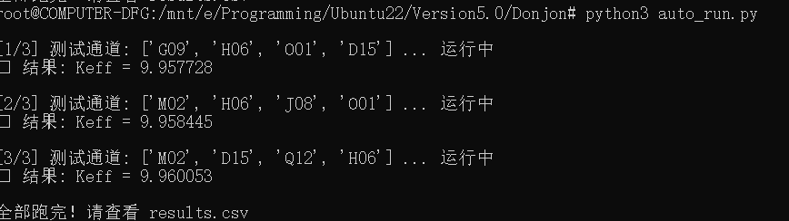
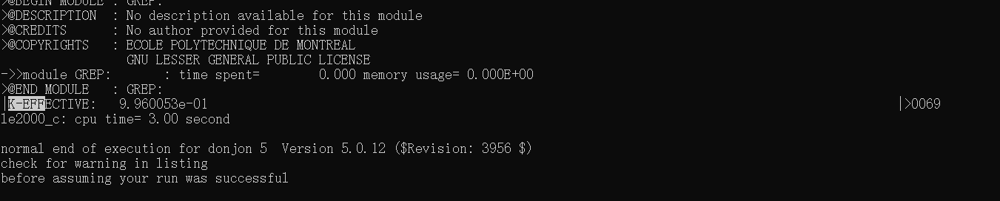
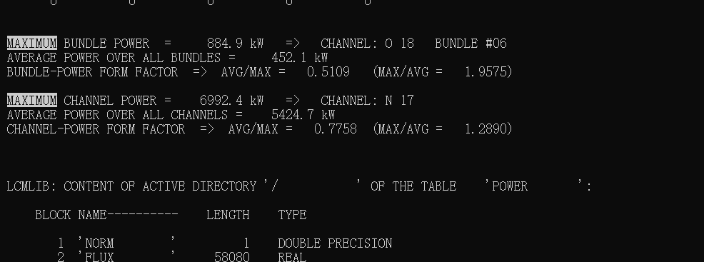

编写python程序批量运行donjon测试不同换料序列地k-eff，未来可以加入提取功率等数据地代码

因为小编发现自己写一个x2m指令文件放在data下面，donjon这个死脾气容不得任何不好的格式，所以小编只好用先用python硬编码，到时候再试试直接写x2m文件
反正这一次把x2m的指令写python里是能成功的，小编也不是很明白原因

自动化代码如下
[python批量测试代码](../自动化/auto_run.py)

为了获取合法的管道名有哪些小编也写了一个提取代码，只需把生成过一次的result文件拖进来即可生成
[python提取代码](../自动化/extract_channels.py)

由于小编采用的技术是，不改变donjon的规则，即不生成多个result文件，所以最后，无论测试多少次，都只会生成一个result文件

实质是每测试一次，就记录数据然后删除result文件，重新生成

这是最后生成的result文件
[result文件](./Material/第一次打通/Candu6.result)

这是小编写的python文件生成的三个文件
[全部result统计文件](./Material/第一次打通/results.csv)
可以看到keff是有变化的，说明这是成功的

result的截图

另外还有三个log文件，这是测试用的，实际使用可以不看
[log1](./Material/第一次打通/run_1.log)
[log2](./Material/第一次打通/run_2.log)
[log3](./Material/第一次打通/run_3.log)