运行官方提供的 Candu6.x2m DONJON算例 （群常数库也是用的官方的，如果要改燃料属性时小编们再自己用DRAGON生成这个）
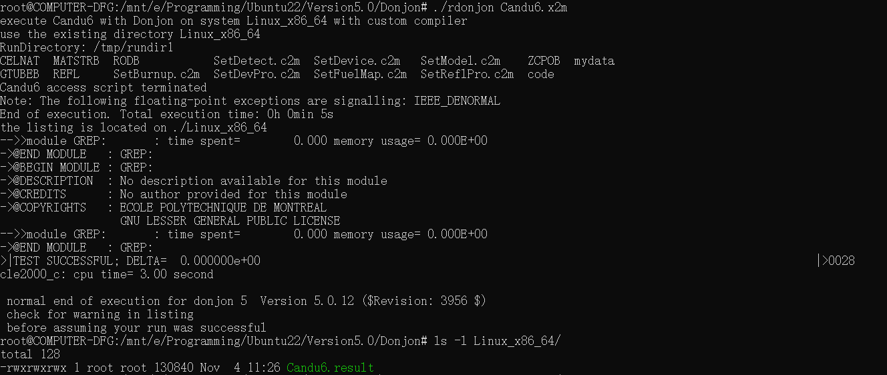
> 误差是零，证明和官方运行的一致，没有问题

产生的K-EFF是0.99625
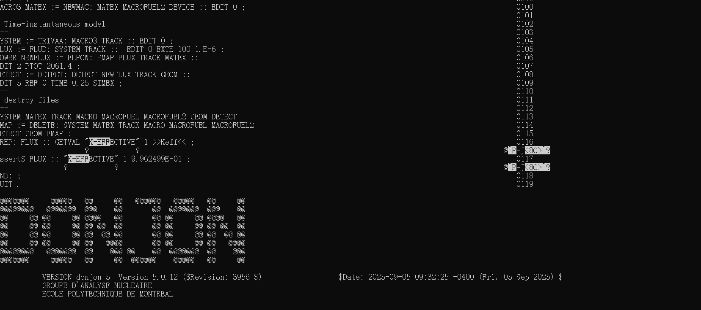

最大通道功率 = 6884.9 kW
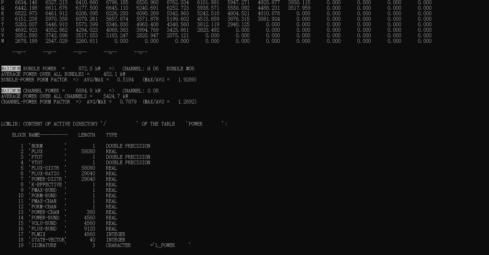

## 改换料序列：
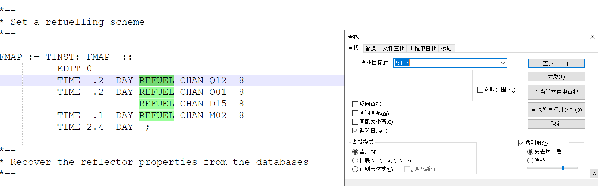

>
> 官方源文件给了个默认的换料序列，大概意思就是 *前 0.2 天换 Q12 和 O01、D15；接下来 0.1 天换 M02；然后空烧 2.4 天*
> **POZOR** 换料序列这个管的名字好像是给定的，不能自己随便取


改掉原版的
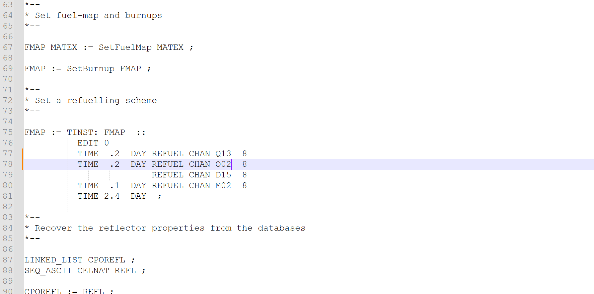

> 改的是两个通道
> 小编对换料序列的更改没任何依据，随便写的，只是为了测试这个程序是对的，换换料序列会让K-EFF和功率变化
> 因为不敢改太多，怕爆了，所以只改了两根管，其他的，哪天换之类的都没改

可以在输出的.result文件里看有哪些合法的通道名
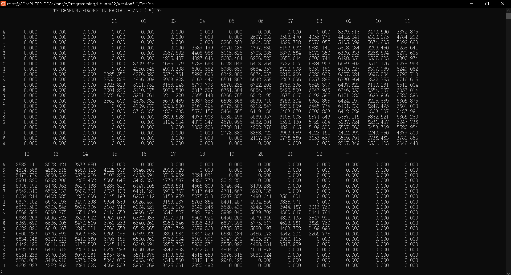

可以看到，改了之后重新运行，导致
```
>|TEST FAILURE
>|REFERENCE= 9.962499e-01 CALCULATED= 9.960147e-01
```
以及Abort终止了
结果是：K-eff 从 0.99625 变成 0.99601
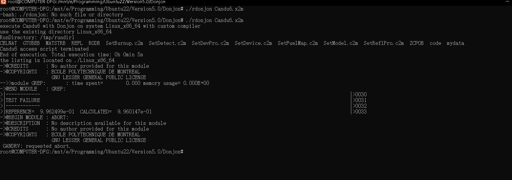

但这也证明改成功了，小编的换料序列的更改修改了物理结果

>
> CANDU6 是一个基准题（Benchmark），为了防止用户算错或者改错文件，写这个算例的专家在代码里写死了一行“断言”（ASSERTS 代码）。
> 只要算出来的 K-eff 不等于 0.9962499，程序就会判定“失败”并停止。

就是这行卡住了，把他注释掉就可以生成新的输出文件了
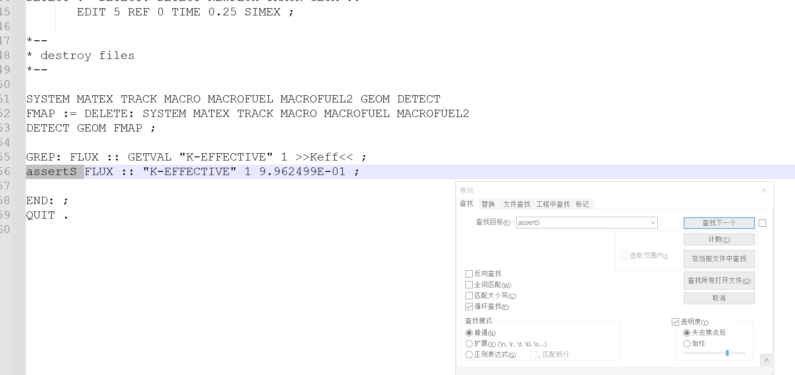

成功了
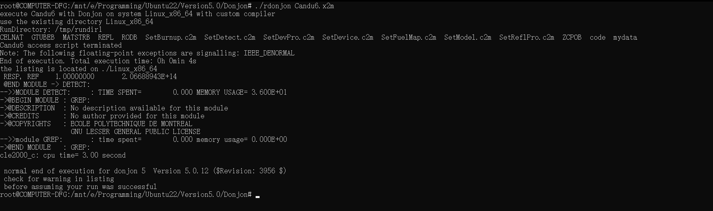

K-EFF变成了 （变小了）
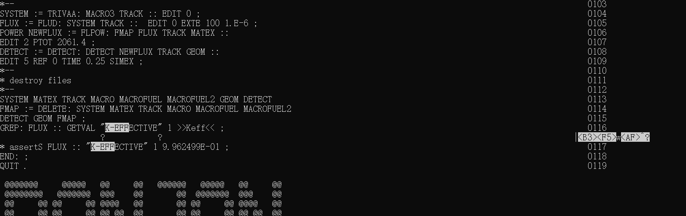

功率变成了	（变小了）
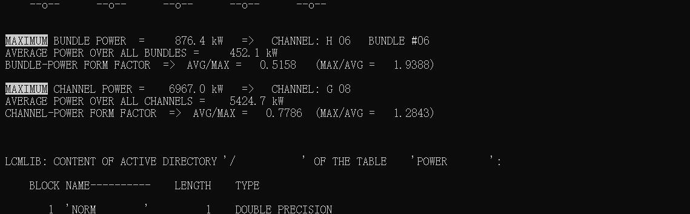

说明小编的随便改让这个程序增殖能力稍微减弱了一点、局部发热更多了