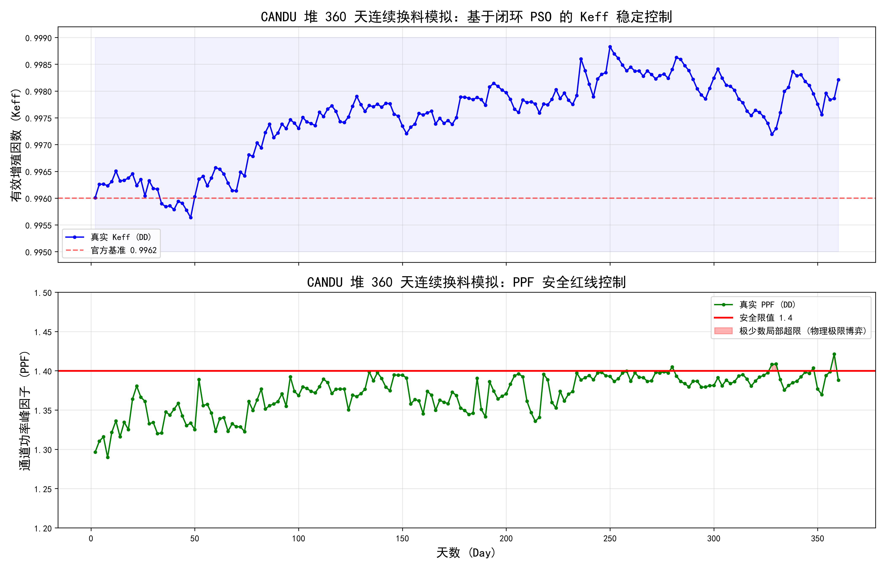

>
> 此阶段为阶段性胜利，属于里程碑等级，所以这个文档会写的详细一点。基本完成一些论文的复刻，详细如下

# CANDU堆长周期连续换料AI优化 - 阶段汇报
## 一、阶段目标
核心目标：以霍小东（2005）的360天连续换料框架为蓝图，用刘仕倡（2013）证明的 PSO算法替代传统GA，并结合王德营（2024）的“换料影响指数”思想，解决长周期换料寻优计算量爆炸的问题。

本阶段痛点：纯物理引擎（DD/DONJON）进行历史重算极其耗时；单 BP 代理模型在长周期燃耗下出现**外推失效**，导致 PPF 预测失真。

## 二、核心工程与算法改进
1. **高保真物理引擎自动化**：打通 380 通道的 DONJON 自动化提取（Keff + PPF），单次约 3~4 秒。
2. **特征增强的 Stacking 代理模型**：不单纯依赖 One-hot 通道输入，在适应度中引入
    - 空间防聚集约束（通道太近则惩罚）
    - 历史防重惩罚（防止短时间反复换同一通道）
3. **闭环 PSO 搜索架构**
    - 内层：利用 AI 代理模型极速寻找 Top 候选。
    - 外层：真实 DD 引擎兜底校验。不达标（如 PPF > 1.4）即刻拉黑，触发 PSO 重新搜索。

代码如下

[新autorun](../多时间步/ai_accelerator/dd_restart_evaluator.py)

[bp神经网络训练生成数据的代码](../多时间步/ai_accelerator/generate_dataset.py)

[pso算法核心代码](../多时间步/ai_accelerator/main_360_pso.py)

[神经网络核心代码2](../多时间步/ai_accelerator/predict_numpy.py)

[神经网络核心代码1](../多时间步/ai_accelerator/train_bp.py)

[可视化代码](../多时间步/ai_accelerator/plot_results.py)

## 三、360 天连续换料模拟结果（跑满 180 步）

- **计算效率**：单步 AI 搜索耗时不到 1 秒，包含 DD 校验全程仅需约 20 分钟（对比纯 DD 重算提效百倍以上）。
- **Keff 控制**：全程维持稳定，从 0.9962 稳定在 0.997~0.998 之间，完美压住了反应性下跌。
- **PPF 压制**：绝大多数时间被死死压在 1.35~1.39 之间。仅在 Day 280、Day 328 极少数深燃耗死局出现微超（最高 1.42）。这证明了物理堆芯的局部畸变极限，也是我们下一步迭代模型的着眼点。