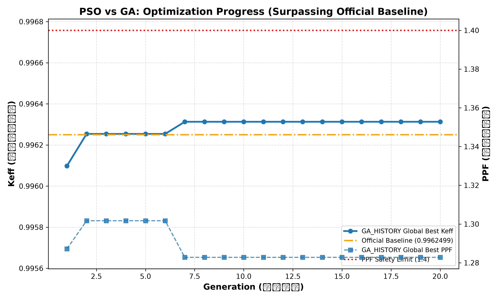
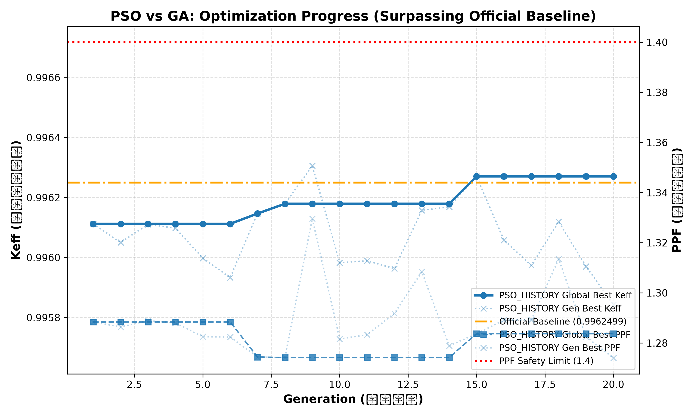
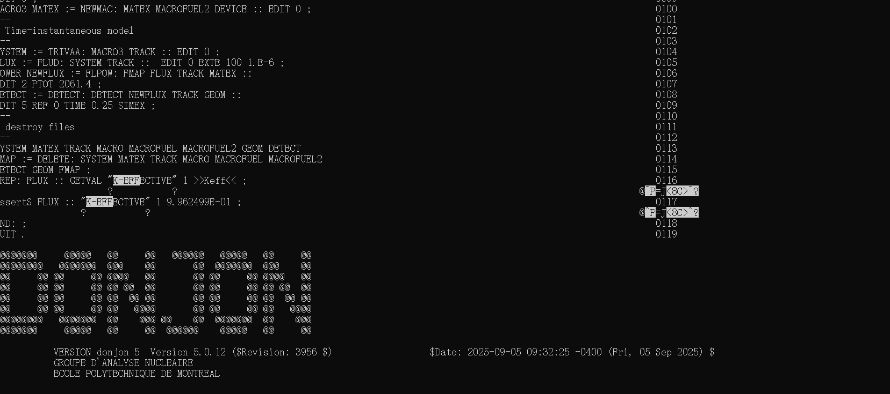

改进PSO与GA代码，加入奖惩，对象是PPF与Keff，Keff为主

[pso的python代码](../自动化/pso_optimizer.py)
[ga的python代码](../自动化/ga_optimizer.py)

重写可视化代码，主要服务于这两个新产生的csv文件

[修改后的可视化python代码](../自动化/plot_results.py)

分别跑出来的数据

[pso](./Material/pso与ga单时间步完全体大概/pso_history.csv)
[ga](./Material/pso与ga单时间步完全体大概/ga_history.csv)

特别地，两个代码都跑出了超越官方源代码换料序列的Keff的数据，并且保持了PPF处于比较低的位置

官方的换料序列的Keff数据

