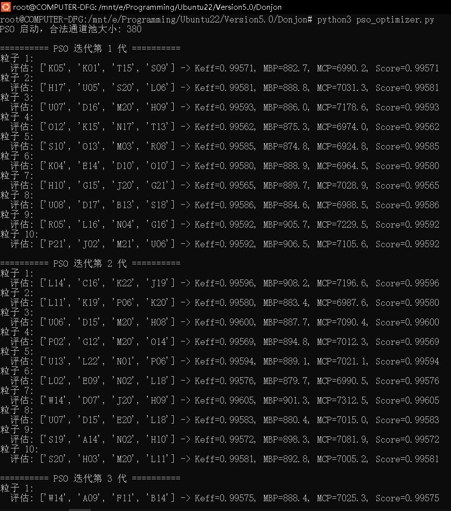
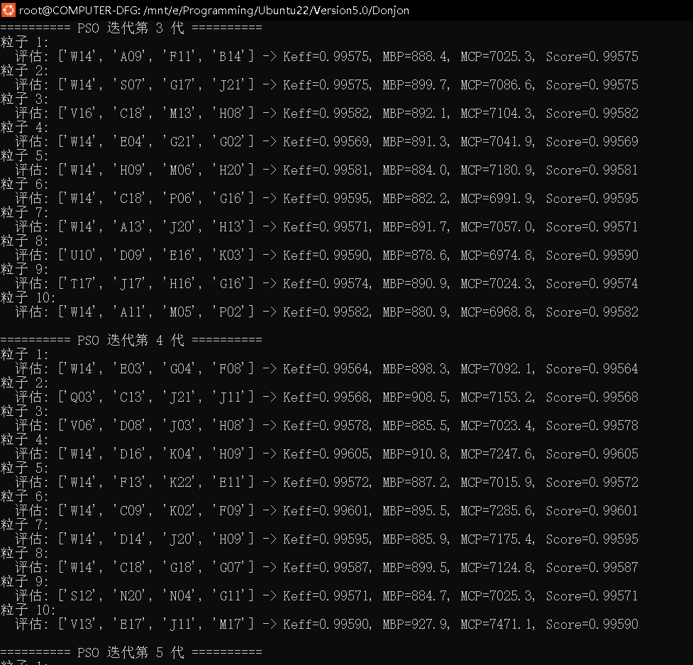
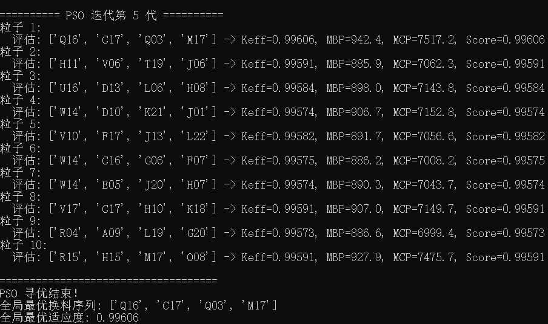
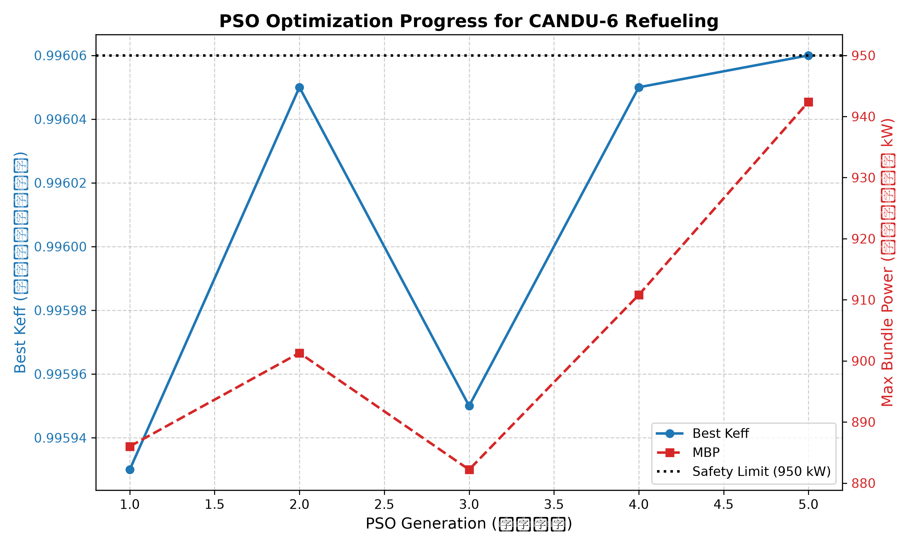

编写了一个pso运行代码，并调用之前写的autorun文件，实现pso搜索
[pso的python代码](../自动化/pso_optimizer.py)

因为要给pso运行代码调用，所以autorun的代码也要改一下，加一个函数接口
[python批量测试代码更改](../自动化/auto_run.py)

更改处

由于之前的管道名提取代码，是提取的result文件，这其实是错的，因为有些管道名可能没有放燃料，但是还是被提取到了，所以会导致运行错误

因此小编写了一个从setfuelmap.c2m这个文件提取管道名的python程序，这个文件里面有些哪些管道有燃料，没有燃料的就不提取

这个setfuelmap.c2m用的也是官方candu6的，目录大概在这里 `Candu6_proc`

[新的提取代码](../自动化/extract_from_c2m.py)

运行结果

产生的日志，实际使用可以不看，只是方便修bug调试

[日志](./Material/pso/temp_run.log)

到现在这一地步result文件已经不重要，详细原因在这里

[上一次的作业文件](./CANDU6批量運行.md)

因此不再展示result文件

bonus

可视化

>
> 由于小编忘记写储存的代码了，所以这次的可视化只是一个临时的一次性的，硬编码，也只是为了展示一下这一次的成果
> 
> 补充了储存数据代码后可以做一个可复用的可视化代码文件

[可视化1](./Material/pso/可视化/extract_pso_log.py)
[可视化2](./Material/pso/可视化/plot_results.py)

生成图片
