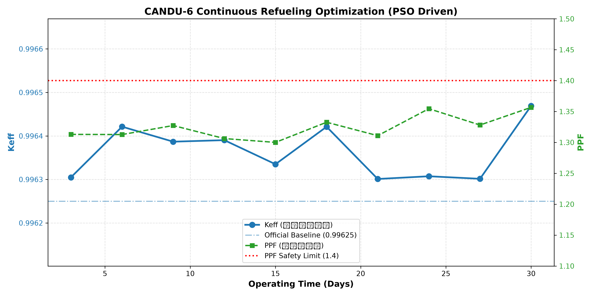
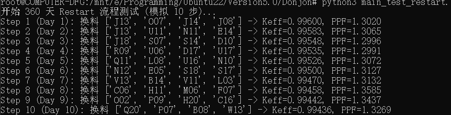

还是基于官方candu6算例做的，多时间步换料模拟

主要加入restart，可以把上一次模拟的堆芯结果储存提交给下一次计算作为初始状态，以此实现多时间步模拟，以达成模拟重水堆不停堆计算的情况

主代码

[autorun](../多时间步/Continuous_360/auto_run_restart.py)

[pso计算代码](../多时间步/Continuous_360/main_360_pso.py)

[对照组代码](../多时间步/Continuous_360/main_test_restart.py)

[可视化代码](../多时间步/Continuous_360/plot_daily.py)

输出结果

>
> 由于360天模拟时间过长，这次第一次运行先用了30天来模拟，但运行时间依然很长

[数据文件](./Material/多时间步/daily_optimization_history.csv)

对照组但没有做可视化，直接看输出就行

可以看到Keff一直在下降，而用了pso智能算法的Keff一直稳定在一个固定的范围内，甚至还能稍微上涨