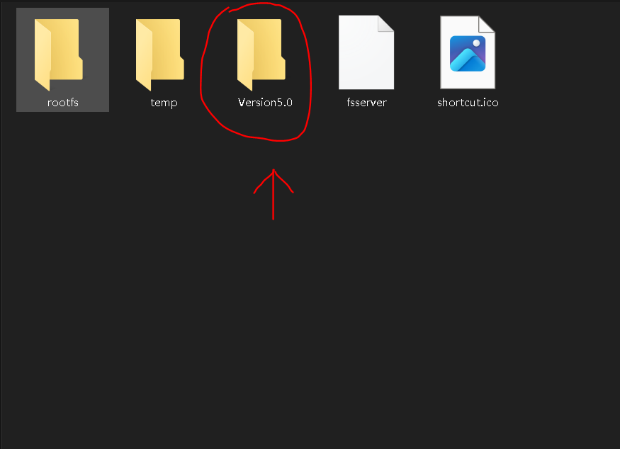
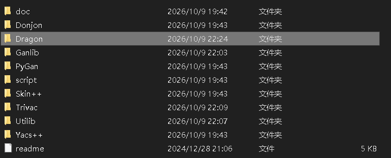
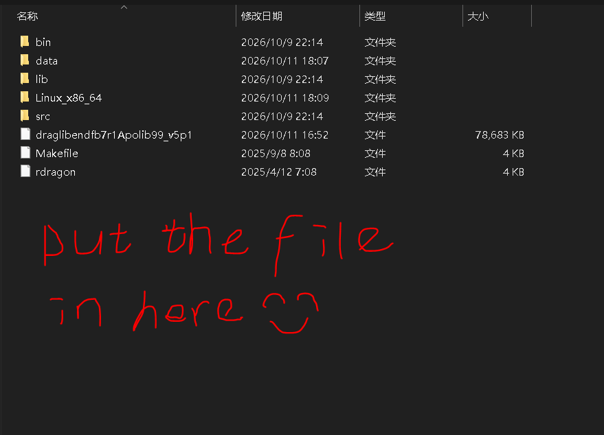
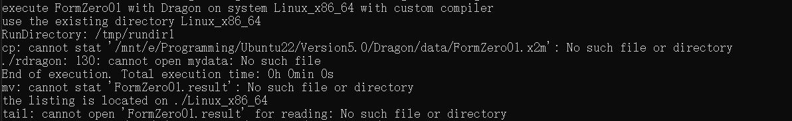

# 从零写一个 MAC 路线算例

> 答案在这里 [FormZero01.x2m](./实例./FormZero01.x2m)

## 目标
写一个能跑的算例，算出一个 1D 圆柱栅元的 keff。

材料就两种（燃料 + 慢化剂）。几何就 2 层圆环。能群 2 群。能跑出结果就算成功。


## 第一步
先画物理图 （画图是很重要的工具！）
```
        ┌─────────────────────┐
        │   ╭───────────╮     │
        │   │  燃料      │     │     ← 内环：燃料（材料 1）
        │   │  (材料1)   │     │
        │   ╰───────────╯     │
        │      水（材料2）      │     ← 外环：水（材料 2）
        └─────────────────────┘
                ↑
            外边界：反射
```
物理参数：
- 内环燃料半径：0.4 cm
- 外环慢化剂半径：1.0 cm

## 第二步
材料数据（随便编的，不要当真）

### 材料 1：燃料

#### 总截面与裂变参数

| 能群 | TOTAL（总截面） | NUSIGF（νΣf） |
| --- | --- | --- |
| 群 1（快） | 0.30 | 0.005 |
| 群 2（热） | 0.80 | 0.10 |

#### 散射矩阵

| 源群 | 目标群 | 截面 |
| --- | --- | --- |
| 1 | 1 | 0.25 |
| 1 | 2 | 0.03 |
| 2 | 2 | 0.65 |
| 2 | 1 | 0.01 |

#### 裂变谱 CHI

所有新生中子全部落在群 1（快群），取值为：

```
CHI  1.0  0.0
```

---

### 材料 2：水

#### 总截面

| 能群 | TOTAL（总截面） |
| --- | --- |
| 群 1（快） | 0.25 |
| 群 2（热） | 1.00 |

#### 散射矩阵

| 源群 | 目标群 | 截面 |
| --- | --- | --- |
| 1 | 1 | 0.20 |
| 1 | 2 | 0.04 |
| 2 | 2 | 0.95 |
| 2 | 1 | 0.02 |

> 
> 水为非裂变材料，不设置 `NUSIGF` 与 `CHI` 参数。

## 第三步
开写

## 第四步
**运行**

把Ubuntu终端跳到你的Dragon的目录里




## 非常重要的一点！！！
由于DRAGON的rdragon运行程序默认运行的是 /data 里面的文件，所以直接把指令文件放根目录会报错，如下：

而 /data 里面的文件太多了，直接把指令文件放进去会很乱，所以小编选择改rdragon的执行文件，让他的选择范围扩大
我也建议各位小伙伴和我一样这样做：

## 改 rdragon 

1. 先备份（万一改错）
```
cd ……
cp rdragon rdragon.bak
```

2. 找到 `cp data/${mydata}` 那一行
```
grep -n "mydata" rdragon
```

会输出所有用到 mydata 的行号和内容。找到类似这一行：
```
xx: cp data/${mydata} ...
```

3. 看到第99行（可能有不同）
```
99: cp "$CodeDir"/data/$mydata ./mydata
```
这一行硬编码了 data/。改成"当前目录有就用当前目录，没有再去 data/"。

4. 用 nano 打开

```
nano rdragon
```

找到第 99 行：nano 里按 Ctrl + _，输入 99，回车，光标会跳到第 99 行。

把第 99 行删掉，换成下面这 5 行
```
if [ -f "$mydata" ]; then
   cp "$mydata" ./mydata
else
   cp "$CodeDir"/data/$mydata ./mydata
fi
```

Ctrl + O，回车确认。Ctrl + X 退出。

5. 运行

这时运行要复杂一点，文件要写全目录
e.g.
```
./rdragon /mnt/e/……/FormZero01.x2m
```
